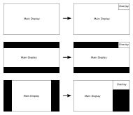
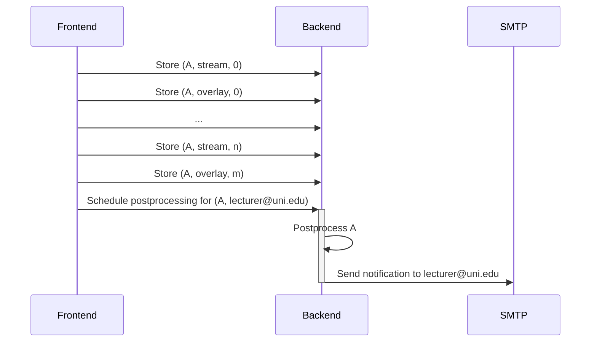

# ISE-Recorder Backend: Technical Documentation

## Purpose

The ISE-Recorder backend combines the tracks recorded by the frontend into one video file such that the main
display (slides) and overlay (speaker video) are arranged in a sensible manner, i.e. such that the speaker is
visible but does not obscure the content on the slides. This may involve cropping of black bars from the slide
stream and rearrangement depending on the format of the slides; the following figure shows the way this backend
treats the main cases:



Note that there is some technical nuance to the positioning of the main display stream: the positioning depends
on the relation between the main display stream's content area after cropping and the output geometry, which we
pick from a pre-defined list (at time of writing 1280x720, 1280x800, 1920x1080). If the recorded screen does not
match the aspect ratio of the output geometry (i.e., captured from a 4:3 device, embedded in 16:9), it will be
positioned as if it had been embedded in a surrounding screen matching the output geometry's aspect ratio (in
this example, matching case 3 of the figure).

The normal, expected case is one main display, one overlay, and one audio stream, where the main display and audio
stream arrive combined as "stream" track from the frontend (see the technical documentation there). In addition
to this, the backend explicitly supports recordings without a video overlay and recordings with multiple audio
tracks. All other inputs are handled in a best-effort manner but considered out of scope for this design spec.

## Workflow

The postprocessing backend of ISE-Recorder is built to accept media streams from the ISE-Recorder frontend
and postprocessing jobs after the streams have ended. The operation is sketched in the following sequence
diagram, which shows the frontend streaming a recording A of two tracks (stream and overlay) of n and m
chunks, respectively, to the backend before scheduling a postprocessing job for recording A with the request
to notify lecturer@uni.edu when postprocessing is complete. Afterwards, the processed recording is available
on the server's filesystem.



The tracks need not have the same number of chunks because browsers can't force the length of media chunks
precisely, so the number of chunks per stream will drift slightly over time.

## API

The API is an HTTP API with the following endpoints under the configured route prefix:

| Endpoint | Method | Purpose | Parameters |
| - | - | - | - |
| `/api/recordings` | GET | Retrieve list of user's recordings | none, needs auth |
| `/api/recordings/{name}` | DELETE | Purge recording from server | none, needs auth |
| `/api/recordings/{name}/tracks/{track}/chunks/{index}` | PUT | Stream chunks of a media stream | recording name, track name, chunk index in the path, chunk data in the body |
| `/api/recordings/{name}/render` | POST | Schedule postprocessing job | recording name, notification email address |
| `/api/downloads/{user_digest}/{name}` | GET | Download recording | TOTP for the recording as returned from `/api/recordings` |
| `/api/downloads/{user_digest}/{name}/raw` | GET | Download raw recording data | TOTP for the recording as returned from `/api/recordings` |
| `/api/health` | GET | Monitoring | none |

The `/api/recordings` GET endpoint retrieves a list of the user's (as identified by the bearer token in the HTTP
`Authorization` header) recordings. Only available in authenticated deployments (will respond 403 otherwise). Each
recording has a name and a state (completed, rendering or unprocessed), and completed recordings also have a size
and a pre-signed, relative download link that's valid for a short while. The frontend is supposed to append this to
the api base url. See the "Downloads" section below for details and an explanation why this is necessary. The shape
of the response is thus

```json
[
    {
        "name": "PSU_2026-10-13T23.26.12.729Z",
        "state": "rendering"
    },
    {
        "name": "PSU_2026-10-06T23.26.12.729Z",
        "state": "completed",
        "size": 123456789,
        "downloadUrl": "downloads/123...def/PSU_2026-10-06T23.26.12.729Z?totp=1234567890"
    }
]
```

The `/api/recordings/{name}` DELETE endpoint purges the recording named `{name}` and returns an empty body. This deletes
both the rendered recording (if available) and the raw chunk data, so it's quite final. May fail with 404 (not found) or
409 (busy, e.g. recording is being rendered). Only available in authenticated deployments (will respond 403 otherwise).

The `/api/recordings/{name}/tracks/{track}/chunks/{index}` PUT endpoint is for streaming chunk data. It follows the
expected PUT semantics in that it's idempotent: If a chunk is uploaded twice, the logical state on the server remains
unchanged. Recording name, track name and chunk index are supplied in the path (as is CRUD convention), the request
body is the chunk binary data as an octet stream. The response body is empty.

The `/api/recordings/{name}/render` endpoint accepts a JSON object (with `Content-Type: application/json`) in the body shaped like

```json
{
    "recipient": "lecturer@uni.edu"
}
```

where `recipient` is optional. This address is used to send completion reports if `request` is configured in
`settings.smtp.recipient_sources`. On success, the endpoint returns in its body the new state of the rendering
recording in the same shape as an element of the `/api/recordings` list. May return HTTP status 404 (recording
does not exist), 422 (not renderable) or 409 (busy).

The `/api/downloads/{user_digest}/{name}` GET endpoint is for downloads of completed recordings, so the response body
is an octet stream with the recording's binary data. This more or less follows the presigned URL pattern: the user
obtains a valid link from the `/api/recordings` GET endpoint and can use it to download the completed recording.
The TOTP must be supplied as a GET parameter (i.e., `?totp=1234...`). See "Downloads" section below for details.
 Only available in authenticated deployments (will respond 403 otherwise).

The `/api/downloads/{user_digest}/{name}/raw` GET endpoint is supplementary to the download endpoint: it allows the
download of the raw (that is, unprocessed) recording data in a zip file. This is interesting when post-processing fails
for some reason or the recording consists of only audio tracks.

The `/api/health` endpoint returns HTTP status 200 and `{ "status": "healthy" }` as long as the server is running; it
is useful for primitive monitoring such as docker health checks.

## Where to find what

All source code is in the `src` directory, most of it into a python module `ise_record`. This module
has two submodules `ise_record.core` and `ise_record.glue`, of which `core` concerns itself with core
functionality such as postprocessing, reporting, and authentication, while the `glue` module is
concerned with binding the core functionality up to a FastAPI server instance, i.e. wrapping it up
in dependables, deciding which HTTP errors to return in case of failure, etc.

### Top-level modules

Directly under `ise_record` there are two modules

| Module | Purpose |
| - | - |
| `server` | API endpoint definition and server instance construction |
| `settings` | Environment settings to influence server behavior |

### Core modules

The `core` submodule is split into a number of sub-submodules, each of which addresses a specific
concern. These are

| Module | Purpose |
| - | - |
| `auth` | Authentication: OpenID and Download-TOTP (see below) |
| `logconfig` | Logging configuration (e.g., filtering out health checks from the log) |
| `postprocess` | Postprocessing logic, i.e. the actual video rendering |
| `recordings` | Identifying which recordings are finished, rendering, still streaming, etc. |
| `reporting` | Notification e-mail sending |
| `user_home` | Preparing user-specific directories to store their recordings |

### Glue modules

The `glue` submodule is likewise split further into submodules.

| Module | Purpose |
| - | - |
| `auth` | Connects core.auth to fastapi |
| `enclave` | User enclaves, describe the state of the user home and transient runtime state associated with a user |
| `jobs` | a wrapper around `core.postprocess` and `core.reporting` to be spawned as a background task |
| `models` | Data types for API parameters and return values, for validation and automatic JSON generation |
| `recordings` | Connects core.recordings to fastapi |
| `reporting` | Determines the reporting address from request and oidc data according to server settings |

## Postprocessing Logic

This backend uses ffmpeg command-line utilities for postprocessing. The process has the following phases:

1. Assemble track-wise video/audio files from the stored chunks so that ffmpeg can process them
    - these are treated as temporaries and removed in the end
    - the stored chunks are kept, so they can be recreated at will
2. Analyze the main display stream with ffprobe to figure out
    - the stream's dimensions
    - whether the stream has black bars that need cropping
    - if it does need cropping, what the actual content area is
3. Generate an ffmpeg filter to generate the desired output
    - pick an output geometry that can accommodate the content area of the main display stream
    - crop the main display stream (if necessary)
    - scale the main display stream to match the output geometry
    - position the main display stream as illustrated above
        - in case of vertical black bars, position left
        - in case of horizontal black bars, position vertically centered
    - if there is an overlay stream, scale it to match the unused area and position in the top right
        - scale to match the width of the right black bar in case the main display was positioned left
        - scale to match the height of the top black bar in case the main display was vertically centered
        - in either case, use at least 10% of the output width and height so the speaker remains visible
4. Identify all input files, i.e. stream, overlay, additional audio tracks
5. Combine all those into an ffmpeg command and run it in the background
    - this command renders to a temporary file first and renames it to the final name when finished
    - this makes it possible to tell finished from failed post-processings
6. Clean up when finished

## Recording classification

Recordings are classified along three quasi-orthogonal axes:

1. Activity: is the recording currently being rendered, purged, accepting an upload, or being zipped
   into a raw-data download?
2. Disk state: Does the recording exist? Is it renderable? Does it have a completed render?
3. Is the recording still being streamed?

These are then used to synthesize states for display in the UI: completed, rendering, and unprocessed,
because these allow different operations. Completed recordings can be downloaded, deleted, and
re-rendered, unprocessed recordings deleted and re-rendered, and rendering recordings are just displayed
as a kind of "yes, I exist, but come back later."

Activity is tracked by the application in response to requests: When a postprocessing is scheduled,
the server marks the recording as rendering in its internal state, and clears it when
postprocessing concludes. The same happens for purge requests and chunk uploads, although these states
typically persist much shorter. The purpose is to reject conflicting requests, e.g. purging a recording
while it is being rendered or uploading to a recording that's being purged.

Disk state is read, as the name suggests, from the recording's on-disk state. If the recording
directory does not exist (or is not a directory), the recording is considered *nonexistent*. If it
exists and there is a file `presentation.webm`, the recording is considered *completed*. If it is not
completed and its directory is in a state that postprocessing would not be able to handle, recording
is *unrenderable*, and otherwise it is *unprocessed*.

Streaming state is determined by the upload time of the last chunk in a recording and the last time
a render was scheduled for it. If the last uploaded chunk is older than two minutes or if a render
has been scheduled afterwards, then the recording is not streaming, otherwise it is. This is somewhat
heuristic across server restarts, but the stakes are low: if it takes two minutes for a failed rendering
to appear in the list of server-side recordings after the backend has restarted, that's acceptable.

## Authentication

The backend supports optional OpenID-Connect-based authentication. In this mode, the backend expects an
`Authorization: Bearer $token` header with an access token with every query, which it validates locally
without per-request calls to the OIDC provider. At server start, it attempts to discover the OIDC provider's
issuer and jwks endpoint, then feeds those to a PyJWT `PyJWKClient`, which handles the key retrieval and
refreshes. The actual token validation and decoding is then also based on PyJWT.

At the moment, the backend does not attempt to distinguish between access and id tokens other than
checking the audience claim against the configured value, i.e. the header is not inspected for
`"typ": "at+jwt"`. This will change in the future, when all common OIDC providers mint their tokens with
that type. Note that there exist OIDC providers where the audience check is unreliable, in particular
kanidm, which forces client id and audience to the same value. They do set `"typ": "at+jwt"`, and that will
ultimately be the test. For the moment, though, I don't have a reliable way to tell apart id and access
tokens from all OIDC providers out there, and as far as I can make out, relying on the audience field
seems to be the standard workaround. So I'm doing that for now.

The access tokens are used to establish trust, i.e. that a request is allowed to store data and schedule
jobs. There are no custom scopes, right now it's all-or-nothing when it comes to permissions. The user's
home directory is derived from `sub`. This is stable but not human-readable, so if `preferred_username`
is present in the token or can be found out through a query against the OIDC provider's `userinfo_endpoint`,
the backend derives a human-readable alternative name from `sub` and `preferred_username` for a symlink
to the stable directory.

The backend can also use the `email` and `email_verified` claims for reporting purposes. This is
configurable in `settings.smtp.recipient_sources`. Token claims are used if available, otherwise they're
read from the `userinfo_endpoint` along with `preferred_username`.

## Downloads

Because browsers can't (easily) be made to attach bearer tokens to download requests, we use a
TOTP-based mechanism to authenticate downloads. When the frontend asks for a list of available processed
recordings, the backend generates a TOTP for each file in the list and sends it along with the list of
available files. The frontend attaches the TOTP to the download link as a GET parameter, and the backend
allows downloads only with a matching TOTP. The OTPs are valid for 2-4 minutes, and the frontend keeps
polling the backend for new OTPs every minute.
